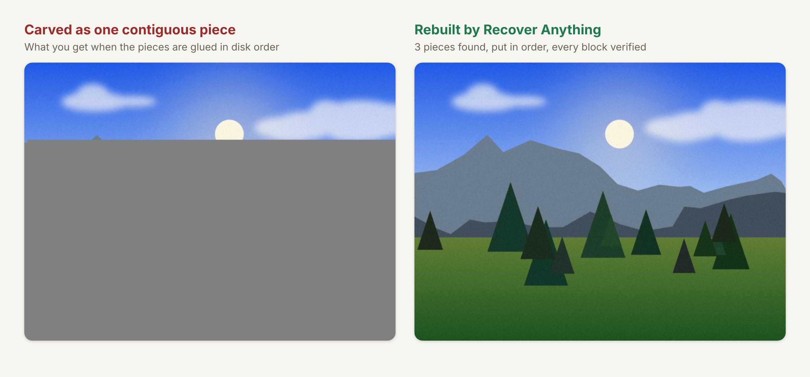
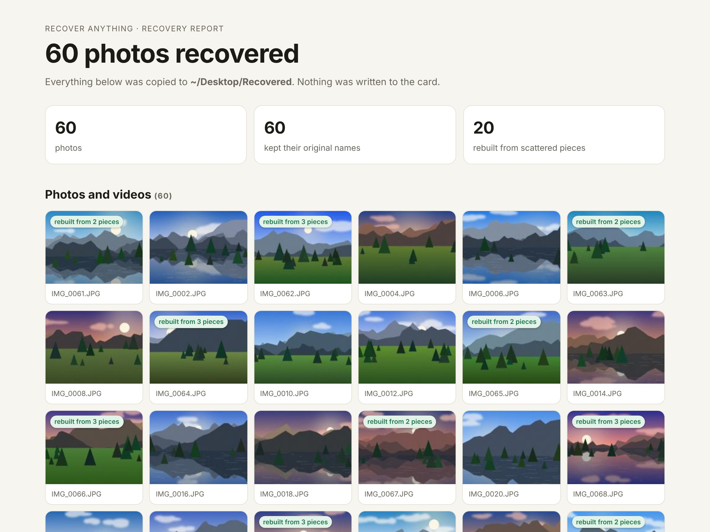
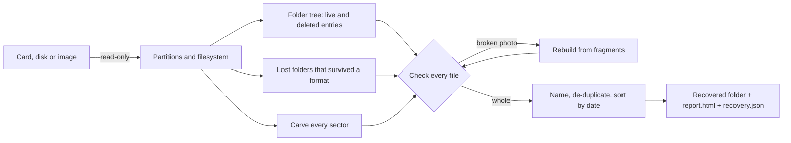

# Recover Anything

**Your deleted photos are probably still there. Get them back safely, with one command or by asking your AI agent.**

[](https://github.com/RuikunWang506/recover-anything/actions/workflows/ci.yml)




Deleted photos from your camera? Formatted the wrong SD card? Seeing "this card needs to be formatted"? Recover Anything reads the card **without ever writing to it**. It finds every photo, video and document it can, and **rebuilds photos that were stored in scattered pieces**. Original file names come back **even after a format**. It checks every file and gives you a sorted folder plus a plain-language report.

It's one pure-Python package with zero dependencies. It also ships a skill, so Claude Code or Codex can run the whole rescue for someone who has never opened a terminal.

## Quick start

```bash
pipx install git+https://github.com/RuikunWang506/recover-anything

recover-anything devices                                   # which disk is the card?
sudo recover-anything triage /dev/rdisk4                   # honest odds, and what not to do
sudo recover-anything recover /dev/rdisk4 -o ~/Desktop/Recovered
```

Linux cards look like `/dev/sdb` or `/dev/mmcblk0`; Windows uses `\\.\PhysicalDrive2` in an Administrator terminal. Reading a card directly needs administrator rights; the recovered files are handed back to your own user. You can also point it at a disk image.

You get a folder sorted by month, plus a report you can open in any browser:



### Or let your agent do it

```bash
recover-anything install-skill      # installs the skill for Claude Code and Codex
```

Then ask: *"I formatted my camera's SD card by accident. Can you get my photos back?"* The [skill](skills/recover-anything/SKILL.md) teaches the agent the rules a recovery expert follows:
- stop using the card
- never "repair" it
- copy it first
- never save onto it
- be honest about the odds

## Results

Every number here is reproducible: `recover-anything selftest` for the table, `recover-anything selftest --stress 9` for the stress test. It builds simulated SD cards (FAT32 and exFAT, camera-style photos with EXIF and thumbnails) and wrecks them the way people do. Then it runs the real recovery and compares every recovered file byte for byte with the original.

| Simulated card | Filesystem | Recovered byte for byte | Kept original names | Notes |
|---|---|---|---|---|
| Accidentally deleted (63 photos + 1 video) | FAT32 | **64 / 64 (100%)** | 64 | |
| Formatted | FAT32 | **64 / 64 (100%)** | 64 | names restored from folders that survived the format |
| Formatted, then 20 new photos taken | FAT32 | **43 / 43 (100%)** of what survived | n/a | 20 old photos were physically overwritten by the new ones: gone for any tool |
| Heavily fragmented, then formatted | FAT32 | **60 / 60 (100%)** | 60 | all 20 photos that were split into pieces rebuilt |
| Accidentally deleted | exFAT | **64 / 64 (100%)** | 64 | |
| Formatted | exFAT | **64 / 64 (100%)** | 64 | |
| Heavily fragmented, then formatted | exFAT | **60 / 60 (100%)** | 60 | all 20 fragmented photos rebuilt |

Each card is a 4 GB SD card image with 32 KB clusters; each run takes 20 to 30 seconds on a 2-core cloud VM.

**Stress test.** We ran randomized cards with three rounds of shooting and deleting, mixed JPEG encoders (standard, optimized, restart markers, high quality) and 8 to 32 KB clusters. Each card was then formatted in-camera, which recreates the folders and erases the names. Across 9 randomized cards, it rebuilt **104 of 104 fragmented photos** and **32 of 32 videos** (12 of them fragmented), and recovered **432 of 432 files byte for byte**. No file was ever marked recovered unless it matched the original exactly. The cards come from fixed seeds, so every run builds exactly the same cards.

> These are simulated cards built to behave like real ones. Reports from real hardware are very welcome: open an issue with what happened and what came back.

## What makes it different

- **It never writes to your card.** It opens the device read-only and copies it to an image first when there's room, and it never runs "repair" tools. Before saving anything, it works out every physical disk a write into the output folder could land on, by device identity rather than by path. It follows bind mounts, LVM and encrypted volumes, overlay and FUSE folders, disk images stored on the card (loop devices, `.dmg`, `.vhd`), Windows links, junctions and `\\?\` paths, and network shares served by the computer itself. It refuses if any of them is the card, or if it can't tell. Each card copy is fingerprinted by its partition table, boot area and file listing, so one card's copy is never reused for another.
- **Fragmented photos and videos come back whole.** When a camera fills the hole left by a deleted photo, the next photo (or video) is split across several places. After a format, ordinary carvers glue the pieces together in disk order, and you get the gray half-picture above. Recover Anything decodes each photo as it walks the card. It notices the moment the bytes stop belonging to that photo, then finds the piece that continues the picture. Videos are rebuilt using their own index, which lists where every frame must start. A photo only counts as recovered when its last block decodes, the image ends exactly where it should, and the picture matches the small preview the camera stored inside it; a video only counts when every frame is where its index says.
- **Original names survive a format.** A quick format wipes the file table but usually leaves folders like `DCIM/100CANON` sitting in the data area. Recover Anything finds them, so you get `IMG_0042.JPG` back instead of `f12345678.jpg`.
- **Every file is checked, and the report says how.** Photos are decoded block by block. H.264/HEVC videos have every frame's position and header checked against their own index, and iPhone photos (HEIC) every tile's. PNG, ZIP and Office files have their checksums verified. PDF objects and compressed streams, AVI frames and GIF pictures are checked too. Formats whose contents can't be checked (a RAW's sensor data, WAV) only count as recovered if they were never deleted; otherwise they're saved and labeled. Anything incomplete or damaged goes to a separate *Partly recovered* folder with a label, rather than being dropped.
- **Honest odds.** `triage` tells you up front when recovery is unlikely: internal SSDs with TRIM, encrypted volumes, cards that were fully erased.
- **It looks everywhere else too.** When the bytes are gone, `hunt` searches the other places a copy can survive (see below).

## When an AI agent (or `rm -rf`) deleted your files

```bash
recover-anything hunt --project ~/code/myapp               # everything that lived in that folder
recover-anything hunt "thesis.docx" --save ~/Desktop/Found # copy whatever it finds
```

`hunt` is read-only and checks:
- **Claude Code transcripts**, which contain every file the agent wrote, edited or fully read. `hunt` replays them to rebuild the latest version.
- **Codex session logs** (files it created).
- **Git**: commits lost to `reset --hard` or a rebase, staged-but-never-committed content, and stashes.
- **Editor history**: VS Code, Cursor and Windsurf local history, and JetBrains Local History.
- **The trash** or Recycle Bin.
- **Snapshots**: Time Machine local snapshots, Windows shadow copies and File History, and btrfs, ZFS and Timeshift snapshots.
- **Desktop thumbnail caches**, which keep small previews of deleted photos.

It also lists the cloud places to check by hand: Google Photos trash, iCloud Recently Deleted, Google Drive, OneDrive, Dropbox, and the chats you sent the file in.

## How it works



1. **Filesystem pass.** FAT12/16/32 and exFAT are parsed directly. Deleted entries keep their name, size, date and first cluster. On exFAT they usually also say whether the file was stored in one piece.
2. **Lost folders.** Directory clusters still in the data area after a format are recognized by their structure and stitched back into paths. A top folder holding only `100CANON`-style folders is named `DCIM` again.
3. **Carving.** Every 512-byte sector of the whole device is checked for the signatures of more than 20 format families: photos (JPEG, HEIC, PNG, GIF, BMP, TIFF-based RAW, CR3, Photoshop), videos (MP4/MOV, dashcam and camcorder streams, MKV/WebM, AVI), audio (MP3, FLAC, Ogg/Opus, WAV, AMR), documents and archives (PDF, Office old and new, ZIP, RAR, 7z, gzip) and SQLite databases. Looking at every sector, not just cluster starts, finds files left over from an earlier format with a different layout. Each hit is measured to its exact length by parsing the format, not by guessing.
4. **Checking.** A pure-Python baseline JPEG decoder walks the image data, and a deleted photo is compared with the preview the camera stored inside it. MP4/MOV sample tables and the item tables of iPhone photos (HEIC) are verified against the bytes they point to, MKV and WebM frames are checked one by one (H.264 and H.265 units, VP9 and VP8 headers and the sizes they give, AV1 units), and ZIP/Office members are decompressed and checksummed. FLAC, Ogg and gzip carry their own checksums, and so do PDF streams. AVI frames and GIF pictures are decoded, SQLite databases get SQLite's own integrity check, and recordings are checked frame by frame and against their own clocks. A file type that can't prove its contents (BMP, WAV, a RAW's sensor data, old Office, AMR, and MP4 or M4A files with no video frames to check) is only called recovered if it was never deleted; otherwise it is saved and labeled. A file that breaks a parser is labeled "could not be checked"; it never stops the run.
5. **Reassembly.** For a broken photo, the reassembler skips clusters that belong to other verified files and tries candidate clusters in order. It decodes a few KB of each and scores how smoothly the picture continues across the seam. It keeps going until the decoder reaches the last block with exactly the right count. Then it compares the picture with the photo's own preview: a piece of another photo that happened to decode shows up as a stretch that doesn't match, and the reassembler tries other pieces there. If the evidence is ambiguous, it refuses to guess and saves the readable top of the picture instead. For a broken video, it finds the frame index (searching free clusters for it when it sits at the end of the file), then lays the frames out cluster by cluster. Every listed frame start is a checkpoint that random data almost never passes. Music, voice memos, dashcam and camcorder clips, gzip archives, Word and Excel files (and everything else stored as ZIP), PDFs, trail-camera videos (Motion-JPEG AVI) and GIFs are rebuilt the same way, unit by unit: each member of an archive must match its checksum and each compressed part of a PDF its own, and the archive's directory or the PDF's table must list exactly what was found. A join is only trusted when a checksum or the recording's own clock confirms it, because another recording's frames look just like this one's. MP3 has no clock: a rebuilt song is only called recovered when each piece follows the last with nothing else that could have come between, and its frames' bookkeeping (the bit reservoir) carries on across the join. Otherwise it is saved as "check that it plays".
6. **Output.** A file found inside another one (a RAW's preview, a photo stored in a ZIP, a frame of a Motion-JPEG video) is dropped only when the container's own structure points to it, so a damaged RAW can't swallow the photos after it. Files go into `Photos/2026-07/`, `Videos/…`, `Audio/`, `Documents/` and `Partly recovered/`. Each file is named by its original name or capture time, given its original date, and de-duplicated. You also get `report.html` and a `recovery.json` that records where every piece came from on the card.

## Commands

| Command | What it does |
|---|---|
| `recover-anything devices` | List disks and cards, mark which one is your system disk |
| `recover-anything triage SOURCE` | Identify the filesystem, sample how much data is still there, give honest odds and the don'ts |
| `recover-anything image SOURCE card.img` | Make a read-only copy first (uses GNU ddrescue when installed, otherwise skips and logs unreadable sectors) |
| `recover-anything recover SOURCE -o DIR` | Find, check, rebuild and save everything. `--only photos,videos`, `--include-live`, `--direct`, `--fast`, `--deep`, `--json` |
| `recover-anything hunt [QUERY]` | Look for surviving copies elsewhere. `--project DIR`, `--save DIR`, `--json` |
| `recover-anything selftest` | Reproduce the results table on simulated cards (needs Pillow). `--stress N` runs N randomized cards |
| `recover-anything install-skill` | Teach Claude Code / Codex to drive all of this safely |

Everything has `--json` for agents and scripts.

## What's supported

- **Filesystems with names and folders:** FAT12, FAT16, FAT32, exFAT (SD, SDHC and SDXC cards, USB sticks, most cameras and drones).
- **Anything else** (NTFS, HFS+, ext4, a wiped or unknown card, a card reformatted with different settings): carving still finds the files, without names. A damaged FAT32 or exFAT boot sector is read from its backup copy, and an image cut short by read errors is used as far as it goes.
- **File types:**
  - Photos: JPEG, HEIC/HEIF, AVIF, PNG, GIF, WebP, BMP, Photoshop (PSD/PSB), RAW (CR2, CR3, NEF, ARW, DNG, ORF, RW2, PEF).
  - Videos: MP4, MOV, M4V, 3GP, AVI, MKV, WebM, dashcam and camcorder clips (TS, MTS/M2TS, MPG/VOB/MOD).
  - Audio: MP3, FLAC, Ogg/Opus, WAV, M4A, AMR.
  - Documents and archives: PDF, DOCX, XLSX, PPTX, EPUB, DOC, XLS, PPT, Outlook MSG, ZIP, RAR, 7z, gzip, and SQLite databases (phone messages, browser history).
  - Files the filesystem still names are recovered whatever their type.
- **Fragment reassembly:** baseline JPEG (what cameras and phones write); MP4/MOV/M4V/3GP video with H.264 or HEVC, guided by the video's own frame index; iPhone photos (HEIC), guided by their own tile table; MP3, FLAC, Ogg, dashcam and camcorder clips, gzip, Word/Excel/PowerPoint and other ZIP-based files, PDF, Motion-JPEG AVI and GIF, unit by unit.
- **Platforms:** Linux, macOS and Windows. CI runs the tests and self-test on all three (Linux with Python 3.9 and 3.13, macOS and Windows with 3.13). It also attaches real disk images (a FAT32 `.dmg` on macOS, a `.vhd` on Windows, loop devices on Linux) and checks that the save guard refuses every way of spelling the card. Reading raw devices on real Mac and Windows hardware hasn't been tried by us yet: reports welcome.

## Honest limits

- Data that has been physically overwritten is gone. No software brings it back.
- Deleted files on internal SSDs with TRIM, on modern phones and on encrypted volumes are usually erased or unreadable. `triage` says so and `hunt` is the realistic path.
- Video reassembly covers MP4/MOV/M4V/3GP with H.264 or HEVC video (what cameras, phones and drones record). Clusters that fall entirely inside one large frame can't be checked on their own. When the evidence for one of them is ambiguous, the video is saved but labeled *not fully confirmed* instead of being called recovered.
- Progressive JPEGs (rare from cameras) are recovered when stored in one piece, but not reassembled.
- Fragment reassembly needs the card's current filesystem layout; files left over from an earlier format with different settings are recovered when they're in one piece.
- A RAW's sensor data, WAV audio and non-H.264 videos can't be checked by their contents: a deleted one is saved and labeled rather than called recovered.
- NTFS/APFS/ext4 file names aren't recovered yet (their files are still carved).
- It's pure Python. Full block-by-block checking runs at roughly 1.5 MB/s per CPU core, spread across your cores. Above 8 GB of photos it checks structure plus a random sample by default, and goes full depth if the sample finds anything. `--deep` forces a full check; `--fast` skips it.

## Roadmap

- RAW reassembly; reassembly for videos without a surviving index
- NTFS undelete with names
- Phone backups (iPhone/Android) and chat apps
- An MCP server, and a small desktop app for people who will never open a terminal

## Contributing

Bug reports from real cards are the most valuable thing you can send. If something didn't come back, run `recover-anything triage` on the card and include the output (it contains no file contents). To add a disaster scenario, write a builder in `src/recover_anything/simcard/scenarios.py` and it becomes part of `selftest`. When a randomized card misses a file, `python tools/debug_card.py SEED` shows where each missed file really was and what the recovery found there.

```bash
git clone https://github.com/RuikunWang506/recover-anything && cd recover-anything
pip install -e ".[dev]"
pytest -q
recover-anything selftest --quick
```

## License

MIT. Recover Anything reads disks; it does not bypass encryption or access devices you don't own. Use it on your own cards and drives.
